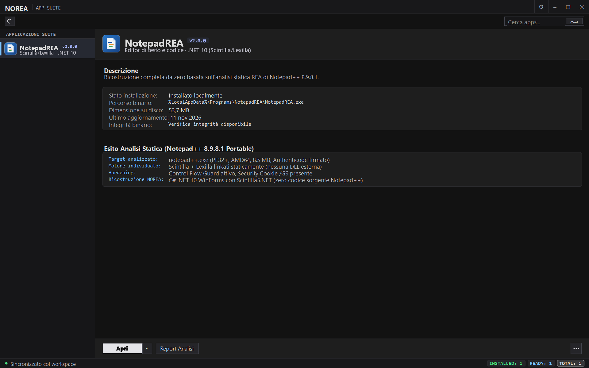

# NOREA — Reverse Engineering & Clean-Room Reconstruction Suite

[](https://github.com/chrisquire80/REA/actions/workflows/release.yml)


[](https://github.com/chrisquire80/REA/releases)


**NOREA** è una suite di ingegneria inversa *clean-room* e ricostruzione nativa ad altissime prestazioni in **C# / .NET 10 Windows**, progettata per analizzare software Win32 legacy ed estrarre componenti, architettura e funzionalità in implementazioni moderne, sicure e modulari con tempo di avvio istantaneo (**< 400 ms**).

---

## 📸 Galleria e Interfaccia

| NoreaLauncher (Master-Detail & Telemetria Live) | Impostazioni & Integrazione PATH / Cloud |
| :---: | :---: |
|  |  |

---

## 📦 Progetti della Suite

### 1. [NotepadREA](file:///c:/Users/ChristianRobecchi/Downloads/REA/NotepadREA/NotepadREA.csproj) (v2.1.0)
Editor di testo e codice sorgente completo, ricostruito da zero a partire dall'analisi statica e dinamica di Notepad++ 8.9.8.1 (PE32+ AMD64).
* **Terminale PowerShell/CMD Incorporato (`F12` / `Ctrl+~`)**: Console interattiva integrata in un cassetto a scomparsa, aperta automaticamente nella cartella del documento corrente per compilare o eseguire script.
* **Confronto File Side-by-Side (`Ctrl+Alt+D`)**: Interfaccia a doppio editor Scintilla con scorrimento verticale sincronizzato, evidenziazione a riga intera (aggiunte, rimosse, modificate) e navigazione con `F7` e `Shift+F7`.
* **Indicatori Git Diff nel Margine**: Barre cromatiche a sinistra dei numeri di riga (verde per aggiunte, blu per modifiche, rosso per cancellazioni) aggiornate in background tramite `git diff`.
* **Ispezione Esadecimale (Hex View Modal - `Ctrl+Alt+H`)**: Visualizzatore esadecimale virtualizzato con colonna byte, decodifica ASCII, ricerca e calcolo automatico dell'**Entropia di Shannon** (utile per rilevare file compressi o offuscati).
* **Suite Strumenti & Formattatori**: Formattazione e minificazione JSON (`Ctrl+Shift+J`), formattazione XML, codifica/decodifica Base64 (`Ctrl+Shift+B`) e URL, ordinamento righe alfabetico (`A → Z` / `Z → A`), rimozione duplicati e pulizia spazi di fine riga.
* **Multi-Caret & Selezione a Colonna**: Supporto nativo a cursori multipli (`Ctrl+Clic`), selezione a rettangolo (`Alt+Trascina` o `Shift+Alt+Frecce`).
* **TextCodec puro & Salvataggio Atomico**: Rilevamento automatico codifiche (UTF-8 con/senza BOM, UTF-16 LE/BE, ANSI di sistema), fallback su file temporaneo con `File.Replace`, protezione da sovrascrittura binari accidentale e UAC fallback per file di sistema (`--elevated-save`).
* **Find & Replace in Files**: Finestra multi-thread parallelizzata (`Ctrl+Shift+F`) con supporto a sottocartelle, regex e navigazione rapida.
* **Librerie Native Incorporate (Self-Healing)**: `Scintilla.dll` e `Lexilla.dll` sono incorporate direttamente nell'eseguibile ed auto-estratte al primo avvio se mancanti su disco, rendendo l'eseguibile autonomo al 100%.

### 2. [NoreaLauncher](file:///c:/Users/ChristianRobecchi/Downloads/REA/NoreaLauncher/NoreaLauncher.csproj) (v1.1.0)
Launcher della suite in stile **Master-Detail (JetBrains Toolbox / Visual Studio)**.
* **Layout Master-Detail & Accessibilità Dark UI**: Superfici scure graduate a contrasto elevato (`#121212`, `#1E1E1E`), badge sobri desaturati conformi ai criteri di contrasto WCAG.
* **Telemetria Live dei Processi**: Monitoraggio in tempo reale di RAM (Working Set), tempo di attività (Uptime), thread attivi e PID per ogni applicazione della suite in esecuzione.
* **Integrazione CLI nel PATH di Windows (1-Click)**: Configura con un clic `%LocalAppData%\Programs\NotepadREA` e `NOREA` nel `PATH` utente con broadcast `WM_SETTINGCHANGE`, permettendo di avviare `notepadrea` o `norea` da qualsiasi terminale.
* **Client Aggiornamenti Cloud (GitHub Releases)**: Verifica automatica all'avvio o manuale delle release pubblicate su GitHub, con download streaming e aggiornamento a caldo.
* **Cronologia File Recenti**: Accesso rapido ai file aperti di recente dall'editor direttamente dal menu contestuale del launcher.
* **Integrità & Rollback**: Calcolo e verifica SHA-256 dei binari con manifesto `manifest.json`. Aggiornamento atomico con backup `.prev` e ripristino di emergenza a caldo.

### 3. [NOREA.Tests](file:///c:/Users/ChristianRobecchi/Downloads/REA/NOREA.Tests/NOREA.Tests.csproj)
Suite di test unitari automatizzati con **xUnit** (32 test passati):
* Test di codifica e decodifica `TextCodec` (UTF-8, UTF-16, BOM, euristica binaria, EOL misti).
* Test per `TextTransformTools` (JSON, XML, Base64, URL, ordinamento, rimozione duplicati).
* Test per algoritmi di diff `DiffEngine` e parser unificato `GitGutter`.
* Test di utilità del launcher `LauncherUtil` (split nomi REA, semantica delle versioni `CompareVersions`, anonimizzazione percorsi, telemetria).

---

## 🛡️ Clean-Room Engineering Guarantee

Il codice sorgente di **NotepadREA** e **NoreaLauncher** è sviluppato **interamente da zero in C# .NET 10**:
1. Nessuna riga di codice C++ o GPL proveniente da Notepad++ è inclusa nei sorgenti o nei binari.
2. Il motore di editing si basa sul componente open source permissivo **Scintilla5.NET** (licenza Scintilla/Lexilla).
3. Tutti i metadati di analisi statica e compatibilità sono documentati in [ANALISI_REA.md](file:///c:/Users/ChristianRobecchi/Downloads/REA/ANALISI_REA.md).

---

## 🚀 Compilazione, Test ed Esecuzione

Requisiti: **.NET 10 SDK** (Windows 10 / 11 x64).

```powershell
# Ripristino e compilazione soluzione
dotnet build NOREA.slnx -c Release

# Esecuzione test unitari (32 test)
dotnet test NOREA.Tests\NOREA.Tests.csproj

# Generazione automatica pacchetto portatile (.zip compatto ~3 MB)
.\crea_pacchetto_portatile.ps1

# Pubblicazione manuale binari ad alte prestazioni in dist\
dotnet publish NotepadREA\NotepadREA.csproj -c Release -r win-x64 --self-contained false -p:PublishSingleFile=true -p:DebugType=none -o dist
dotnet publish NoreaLauncher\NoreaLauncher.csproj -c Release -r win-x64 --self-contained false -p:PublishSingleFile=true -p:DebugType=none -o dist

# Registrazione associazioni file ed estensioni (.txt, .cs, .py, ecc.)
.\installa_associazioni.ps1
```
