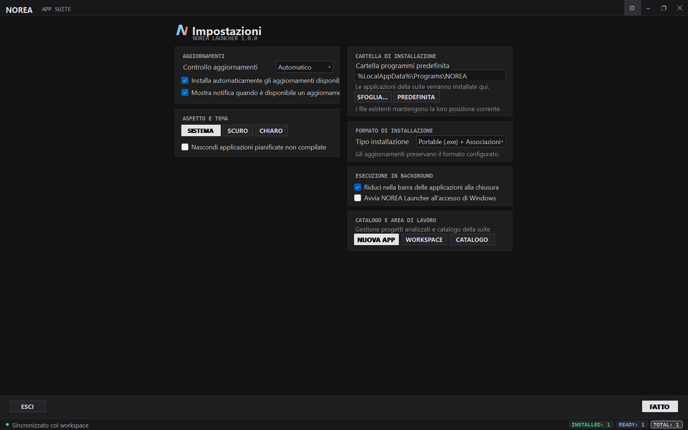

# NOREA — Reverse Engineering & Clean-Room Reconstruction Suite

[](https://github.com/chrisquire80/REA/actions/workflows/release.yml)


[](https://github.com/chrisquire80/REA/releases)


**NOREA** è una suite di ingegneria inversa *clean-room* e ricostruzione nativa ad altissime prestazioni in **C# / .NET 10 Windows**, progettata per analizzare software Win32 legacy ed estrarre componenti, architettura e funzionalità in implementazioni moderne, sicure e modulari con tempo di avvio istantaneo (**< 400 ms**).

---

## 📸 Galleria e Interfaccia

| NoreaLauncher (Master-Detail & Telemetria Live) | Impostazioni & Integrazione PATH / Cloud |
| :---: | :---: |
|  |  |

---

## 📦 Progetti della Suite

### 1. [NotepadREA](NotepadREA/NotepadREA.csproj) (v2.5.0)
Editor di testo e codice sorgente completo, ricostruito da zero a partire dall'analisi statica e dinamica di Notepad++ 8.9.8.1 (PE32+ AMD64).
* **Terminale PowerShell/CMD Incorporato (`F12` / `Ctrl+~`)**: Console interattiva integrata in un cassetto a scomparsa, aperta automaticamente nella cartella del documento corrente per compilare o eseguire script.
* **Confronto File Side-by-Side (`Ctrl+Alt+D`)**: Interfaccia a doppio editor Scintilla con scorrimento verticale sincronizzato, evidenziazione a riga intera (aggiunte, rimosse, modificate) e navigazione con `F7` e `Shift+F7`.
* **Indicatori Git Diff nel Margine**: Barre cromatiche a sinistra dei numeri di riga (verde per aggiunte, blu per modifiche, rosso per cancellazioni) aggiornate in background tramite `git diff`.
* **Ispezione Esadecimale (Hex View Modal - `Ctrl+Alt+H`)**: Visualizzatore esadecimale virtualizzato con colonna byte, decodifica ASCII, ricerca e calcolo automatico dell'**Entropia di Shannon** (utile per rilevare file compressi o offuscati).
* **Suite Strumenti & Formattatori**: Formattazione e minificazione JSON (`Ctrl+Shift+J`), formattazione XML, codifica/decodifica Base64 (`Ctrl+Shift+B`) e URL, ordinamento righe alfabetico (`A → Z` / `Z → A`), rimozione duplicati e pulizia spazi di fine riga.
* **Multi-Caret & Selezione a Colonna**: Supporto nativo a cursori multipli (`Ctrl+Clic`), selezione a rettangolo (`Alt+Trascina` o `Shift+Alt+Frecce`).
* **TextCodec puro & Salvataggio Atomico**: Rilevamento automatico codifiche (UTF-8 con/senza BOM, UTF-16 LE/BE, ANSI di sistema), fallback su file temporaneo con `File.Replace`, protezione da sovrascrittura binari accidentale e UAC fallback per file di sistema (`--elevated-save`).
* **Find & Replace in Files**: Finestra multi-thread parallelizzata (`Ctrl+Shift+F`) con supporto a sottocartelle, regex e navigazione rapida.
* **Librerie Native Incorporate (Self-Healing)**: `Scintilla.dll` e `Lexilla.dll` sono incorporate direttamente nell'eseguibile ed auto-estratte al primo avvio se mancanti su disco, rendendo l'eseguibile autonomo al 100%.

### 2. [NoreaLauncher](NoreaLauncher/NoreaLauncher.csproj) (v2.5.0)
Launcher della suite in stile **Master-Detail**, con palette NOREA chiaro/scuro e componenti condivisi.
* **Layout Master-Detail**: Ricerca rapida, elenco applicazioni, stato e azioni principali coerenti con il sistema di design NOREA.
* **Sistema di design riutilizzabile**: Token colore, tipografia, spaziatura e controlli per i prossimi programmi NOREA in [docs/NOREA_DESIGN_SYSTEM.md](docs/NOREA_DESIGN_SYSTEM.md).
* **Telemetria Live dei Processi**: Monitoraggio in tempo reale di RAM (Working Set), tempo di attività (Uptime), thread attivi e PID per ogni applicazione della suite in esecuzione. I numeri restano sul PC. Cosa viene letto, l'unica richiesta di rete (GitHub Releases) e come spegnere le metriche sono in [docs/TELEMETRIA.md](docs/TELEMETRIA.md).
* **Integrazione CLI nel PATH di Windows (1-Click)**: Configura con un clic `%LocalAppData%\Programs\NotepadREA` e `NOREA` nel `PATH` utente con broadcast `WM_SETTINGCHANGE`, permettendo di avviare `notepadrea` o `norea` da qualsiasi terminale.
* **Client Aggiornamenti Cloud (GitHub Releases)**: Verifica automatica all'avvio o manuale delle release pubblicate su GitHub, con download streaming e aggiornamento a caldo. Il flyout di notifica legge le note da [CHANGELOG.md](CHANGELOG.md), generato dai commit fra i tag: non mostra più il testo di esempio v2.1.0 → v2.2.0.
* **Cronologia File Recenti**: Accesso rapido ai file aperti di recente dall'editor direttamente dal menu contestuale del launcher.
* **Integrità & Rollback**: Calcolo e verifica SHA-256 dei binari con manifesto `manifest.json`. Aggiornamento atomico con backup `.prev` e ripristino di emergenza a caldo.

### 3. [WinSCPREA](WinSCPREA/WinSCPREA.csproj) (v1.0.2)
Client SFTP e file manager Windows a due pannelli, ricostruito da zero in C# / WinForms .NET 10 sulla base dell'analisi statica di WinSCP 6.7.1.
* Connessioni SFTP con password o chiave privata SSH e verifica dell'impronta host SHA-256.
* Salvataggio dei siti senza password; trasferimenti ricorsivi e gestione di file e cartelle remoti.
* Harness Python Click basato su [CLI-Anything](WinSCPREA/agent-harness/cli_anything/winscprea/README.md): `winscprea --json site list`, REPL interattiva e comandi per elenco, trasferimento e gestione remota. La logica SFTP resta condivisa con l'app tramite `NoreaCli` e SSH.NET.
* Perimetro iniziale limitato a SFTP. Analisi e limiti: [ANALISI_WINSCP_REA.md](ANALISI_WINSCP_REA.md).

### 4. [EverythingREA](EverythingREA/EverythingREA.csproj) (v1.0.0)
Motore di ricerca locale istantanea, ricostruito da zero in C# / WinForms .NET 10 sulla base dell'analisi statica di Everything 1.4.1.1032. Il motore è in [EverythingREA.Core](EverythingREA.Core/EverythingREA.Core.csproj); l'interfaccia usa la palette condivisa descritta in [docs/NOREA_DESIGN_SYSTEM.md](docs/NOREA_DESIGN_SYSTEM.md).
* Indicizzazione parallela delle cartelle configurate, cache locale e aggiornamento dei risultati a ogni carattere.
* Sintassi: spazio = AND, `|` = OR, `!` = NOT, wildcard (`*`, `?`), `regex:`, `ext:`, `file:`, `folder:`, `size:>` e `size:<`.
* Apertura del file selezionato in NotepadREA. Analisi e limiti: [ANALISI_EVERYTHING_REA.md](ANALISI_EVERYTHING_REA.md).
* Dalla riga di comando, `norea search` usa lo stesso motore su una cartella (per default la directory corrente) senza avviare la GUI né scriverne la cache.

### 5. [NoreaCli & MCP Server](NoreaCli/NoreaCli.csproj) (v2.5.0)
Interfaccia a riga di comando universale e **Server MCP (Model Context Protocol)** conforme alle specifiche 2024-11-05 per collegare la suite ad agenti AI come **Claude Code** e **Google Antigravity**:
* **Comandi CLI nativi**:
  ```powershell
  norea open Program.cs -n 42        # Apre NotepadREA direttamente alla riga 42
  norea diff file1.txt file2.txt     # Lancia il confronto side-by-side
  norea hex payload.bin              # Ispezione esadecimale ed entropia
  norea notify "Build riuscita!"     # Mostra il flyout toast desktop in stile ArtCraft
  norea list --json                  # Telemetria e stato delle app in formato JSON
  norea launch EverythingREA         # Avvia la ricerca istantanea
  norea search report --root .       # Cerca nella cartella corrente (sintassi EverythingREA)
  norea winscp site list --json      # Siti SFTP, senza salvare la password
  norea setup-ai                     # Configurazione automatica 1-click per Claude Code e Antigravity
  ```
* **Strumenti MCP per Agenti AI**:
  * `norea_open_file`: porta in primo piano un file e posiziona il cursore per far visualizzare all'utente il codice modificato in tempo reale.
  * `norea_compare_files`: apre il diff visivo side-by-side prima di completare merge o refactoring.
  * `norea_inspect_hex`: analisi dei file binari ed estrazione entropia di Shannon.
  * `norea_notify`: notifica sul desktop l'avanzamento o la conclusione di task lunghi tramite flyout toast.
  * `norea_list_apps` & `norea_launch_app`: ispezione e controllo dei processi della suite.

### 6. [NOREA.Tests](NOREA.Tests/NOREA.Tests.csproj) e [NOREA.Benchmarks](NOREA.Benchmarks/NOREA.Benchmarks.csproj)
Suite di test automatizzati con **xUnit** (106 test):
* Test di codifica e decodifica `TextCodec` (UTF-8, UTF-16, BOM, euristica binaria, EOL misti e payload da 16 MiB).
* Test per `TextTransformTools` (JSON, XML, Base64, URL, ordinamento, rimozione duplicati).
* Test per algoritmi di diff `DiffEngine` e parser unificato `GitGutter`.
* Test per `NoreaBridge`, configurazione AI isolata in directory temporanee, persistenza e recupero dei file impostazioni/catalogo malformati ed esclusione automatica di benchmark e suite test.
* Test per applicazione aggiornamenti da archivio: download simulato, hash, rollback e rifiuto di percorsi ZIP esterni alla cartella di installazione.
* Test di integrazione del server MCP JSON-RPC su stream, modifiche ai file aperti e conflitti di salvataggio.
* Test di utilità del launcher `LauncherUtil` (split nomi REA, semantica delle versioni `CompareVersions`, anonimizzazione percorsi, telemetria).
* Test di `EverythingREA.Core` (sintassi di ricerca, cache isolata) e del comando `norea search`.
* Test di `WinSCPREA.Core` e dell'harness `norea winscp`. L'harness Python in `WinSCPREA/agent-harness` ha i propri test pytest, separati dai 106 test xUnit.
* Test della logica estratta dalle finestre: apertura e codifica (`EditorFileSession`), connessione SFTP e chiave host, opzioni di ricerca di EverythingREA, visibilità del catalogo e decisione di aggiornamento.

---

## 🛡️ Clean-Room Engineering Guarantee

Il codice sorgente di **NotepadREA**, **WinSCPREA**, **EverythingREA** e **NoreaLauncher** è sviluppato **interamente da zero in C# .NET 10**:
1. Nessun codice sorgente o risorsa grafica di Notepad++, WinSCP o Everything è incluso nei sorgenti o nei binari delle ricostruzioni.
2. NotepadREA usa Scintilla5.NET; WinSCPREA usa SSH.NET per SFTP. EverythingREA non richiama il binario originale.
3. Le analisi sono documentate in [ANALISI_REA.md](ANALISI_REA.md), [ANALISI_WINSCP_REA.md](ANALISI_WINSCP_REA.md) e [ANALISI_EVERYTHING_REA.md](ANALISI_EVERYTHING_REA.md).

---

## 🚀 Compilazione, Test ed Esecuzione

Requisiti: **.NET 10 SDK** (Windows 10 / 11 x64).

La versione della suite è **2.5.0**, definita in [Directory.Build.props](Directory.Build.props) (`NoreaSuiteVersion`). NotepadREA, NoreaLauncher e NoreaCli la ereditano. WinSCPREA resta **1.0.2** e EverythingREA **1.0.0**: sono versioni di prodotto e sovrascrivono quella della suite nel rispettivo `.csproj`. Il catalogo del launcher (`norea_catalog.json`) usa gli stessi numeri.

```powershell
# Ripristino e compilazione soluzione
dotnet build NOREA.slnx -c Release

# Esecuzione test unitari (106 test)
dotnet test NOREA.Tests\NOREA.Tests.csproj

# Generazione automatica pacchetto portatile
.\crea_pacchetto_portatile.ps1

# Pubblicazione manuale binari ad alte prestazioni in dist\
dotnet publish NotepadREA\NotepadREA.csproj -c Release -r win-x64 --self-contained false -p:PublishSingleFile=true -p:DebugType=none -o dist
dotnet publish NoreaLauncher\NoreaLauncher.csproj -c Release -r win-x64 --self-contained false -p:PublishSingleFile=true -p:DebugType=none -o dist
dotnet publish WinSCPREA\WinSCPREA.csproj -c Release -r win-x64 --self-contained false -p:PublishSingleFile=true -p:DebugType=none -o dist
dotnet publish EverythingREA\EverythingREA.csproj -c Release -r win-x64 --self-contained false -p:PublishSingleFile=true -p:DebugType=none -o dist
dotnet publish NoreaCli\NoreaCli.csproj -c Release -r win-x64 --self-contained false -p:PublishSingleFile=true -p:DebugType=none -o dist

# Registrazione associazioni file ed estensioni (.txt, .cs, .py, ecc.)
# Nel repository usa dist\NotepadREA.exe; nel pacchetto portatile usa NotepadREA.exe accanto allo script.
.\installa_associazioni.ps1
```

La CI (`windows-latest`) compila la soluzione con zero warning attesi, esegue i 106 test xUnit raccogliendo la copertura Coverlet (artefatto `coverage`), esegue `pytest` in `WinSCPREA/agent-harness` e, sulle pull request e su `main`, lancia `crea_pacchetto_portatile.ps1` controllando che lo zip contenga gli eseguibili della suite.

Le action usate in CI e nel workflow di release sono quelle che girano su Node.js 24 (`actions/checkout@v5`, `actions/setup-dotnet@v5`, `actions/setup-python@v6`, `actions/upload-artifact@v6`, `actions/attest-build-provenance@v3`, `softprops/action-gh-release@v3`), così GitHub non deve forzare i runtime Node 20. NotepadREA referenzia Scintilla5.NET ma non importa le DLL native `win-x86` e `win-arm64`: in pubblicazione single-file per `win-x64` restano solo `runtimes\win-x64\native\Scintilla.dll` e `Lexilla.dll`, le stesse incorporate nell'eseguibile e riestratte all'avvio se mancano.

### Benchmark I/O file grandi

Il benchmark misura separatamente hash su buffer/file, lettura+decodifica e codifica+scrittura. Riporta la mediana dei tempi e le allocazioni gestite per operazione; non è un test di regressione prestazionale e i risultati dipendono da disco, runtime e dimensione della cache.

```powershell
# Usa 1, 16 e 64 MiB con 3 iterazioni; personalizzabile con dimensioni e iterazioni
dotnet run --project NOREA.Benchmarks\NOREA.Benchmarks.csproj -c Release -- 1,16,64 3
```

### Verifica provenienza del pacchetto di release

Ogni release allega `NOREA_Suite_Portable.zip` e `checksums.txt` (SHA-256 dello zip).
Il launcher, in `NoreaLauncher/CloudUpdateService.cs`, rifiuta un aggiornamento se
l'asset GitHub non espone un digest `sha256:` di 64 cifre esadecimali, e confronta
quel digest con l'hash del file scaricato. GitHub calcola il digest al caricamento
dell'asset: non dipende dall'attestazione Sigstore.

L'attestazione di provenienza (`actions/attest-build-provenance`) viene eseguita solo
quando il repository è pubblico oppure appartiene a un'organizzazione. Sui repository
privati di un account personale GitHub risponde
`Feature not available for user-owned private repositories` e il passo viene saltato,
insieme alla verifica `gh attestation verify`. Il controllo SHA-256 resta invariato.

Sui repository in cui l'attestazione è disponibile:

```powershell
gh attestation verify NOREA_Suite_Portable.zip --repo chrisquire80/REA
```

### Ripubblicare gli asset di un tag già esistente

Le release `v2.4.0` e `v2.5.0` (e, se priva di asset, anche `v2.4.1`) sono arrivate
ai test ma si sono fermate sull'attestazione, quindi lo zip non è stato caricato.
Dopo il merge di questa correzione su `main`:

1. Apri **Actions → Build & Release Portable Suite → Run workflow**.
2. In **Use workflow from** scegli il branch `main`. Non scegliere il tag vecchio: quel commit contiene ancora il workflow che fallisce.
3. Input `tag`: `v2.4.0`. Lascia `mark_as_latest` disattivato. Il workflow verifica che il tag esista, ne fa il checkout e allega gli asset a quella release. Non crea e non sposta tag.
4. Ripeti per `v2.4.1` se anche quella release è senza zip, sempre con `mark_as_latest` disattivato.
5. Ripeti con `tag` = `v2.5.0` e `mark_as_latest` attivo, così la release più recente resta quella predefinita.

In alternativa, per pubblicare una versione nuova, crea il tag `vX.Y.Z` sul commit desiderato e fai push: il push di un tag `v*` avvia lo stesso workflow. Non serve ricreare i tag `v2.4.0` / `v2.5.0` se l'obiettivo è solo allegare gli asset mancanti al sorgente di quei tag.
